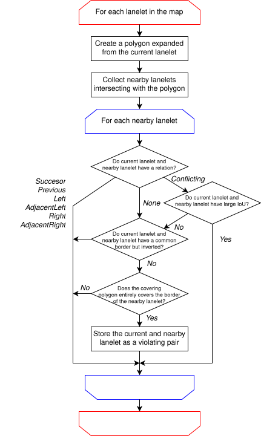
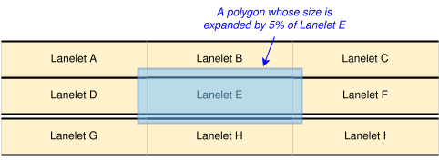
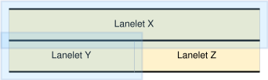
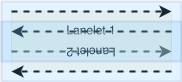

# border_sharing

🇬🇧 **English ver** | 🇯🇵 [日本語 ver](./border_sharing_ja.md)

## Validator name

mapping.lane.border_sharing

## Feature

This validator checks whether physically adjacent lanelets share the same linestring as their border, and whether lanelets separated by a fence don't share their border.
See Autoware Documentation [vm-01-03 Linestring sharing](https://autowarefoundation.github.io/autoware-documentation/main/design/autoware-architecture/map/map-requirements/vector-map-requirements-overview/category_lane/#vm-01-03-linestring-sharing) and [vm-01-04 Sharing of the centerline of lanes for opposing traffic](https://autowarefoundation.github.io/autoware-documentation/main/design/autoware-architecture/map/map-requirements/vector-map-requirements-overview/category_lane/#vm-01-04-sharing-of-the-centerline-of-lanes-for-opposing-traffic) for more information.

This validator may misjudge lanelets that are very close but not adjacent in the real world.

The validator will output the following issues with the corresponding primitive ID. Read [Algorithm](#algorithm) to understand the difference between "Lane.BorderSharing-001" and "Lane.BorderSharing-002", and [Lanelets sharing a border across a fence](#lanelets-sharing-a-border-across-a-fence) for "Lane.BorderSharing-003" and "Lane.BorderSharing-004".

| Issue Code             | Message                                                                                   | Severity | Primitive | Description                                                                                                                                                                                                                                                                                                                                                        | Approach                                                                                                                                                                                                                                  |
| ---------------------- | ----------------------------------------------------------------------------------------- | -------- | --------- | ------------------------------------------------------------------------------------------------------------------------------------------------------------------------------------------------------------------------------------------------------------------------------------------------------------------------------------------------------------------ | ----------------------------------------------------------------------------------------------------------------------------------------------------------------------------------------------------------------------------------------- |
| Lane.BorderSharing-001 | "Seems to be adjacent with Lanelet \<ID\> but doesn't share a border linestring."         | Error    | Lanelet   | The validator judged that the lanelet and lanelet \<ID\> is adjacent with no fence on the border but doesn't share a border linestring. **Note that the same issue will be created against lanelet \<ID\> so two issues rise from one violation.**                                                                                                                 | Create a common border linestring of both lanelets and set the left bound or right bound of them to that linestring. If a fence lies between them in the real world, draw the fence on the border using the points of the border instead. |
| Lane.BorderSharing-002 | "Seems to be adjacent with Lanelet \<multiple IDs\> but doesn't share a border linestring | Error    | Lanelet   | The validator judged that the lanelet and lanelet \<ID\> is adjacent with no fence on the border but doesn't share border linestrings. The difference with the above is that this violation may be caused from incorrect lanelet division, and the issue will be made only for the largest lanelet. (The same issue will not be made for lanelet \<multiple IDs\>) | Divide this lanelet properly and then set a common border linestring to each adjacent lanelet. If a fence lies between them in the real world, draw the fence on the border using the points of the border instead.                       |
| Lane.BorderSharing-003 | "Shares a border linestring with Lanelet \<ID\> although a fence lies between them."      | Error    | Lanelet   | The lanelet and lanelet \<ID\> share a border linestring, and a linestring with `type:fence` lies on the border. **Note that the same issue will be created against lanelet \<ID\> so two issues rise from one violation.**                                                                                                                                        | Create separate border linestrings for the two lanelets. If no fence exists in the real world, remove the fence linestring from the map instead.                                                                                          |
| Lane.BorderSharing-004 | "Shares a border linestring of type fence with Lanelet \<ID\>."                           | Error    | Lanelet   | The lanelet and lanelet \<ID\> share a border linestring whose type is `fence`. **Note that the same issue will be created against lanelet \<ID\> so two issues rise from one violation.**                                                                                                                                                                         | Create separate border linestrings for the two lanelets. If no fence exists in the real world, change the type of the shared border to a type other than `fence` instead.                                                                 |

## Algorithm

### Overview

The overview of the algorithm is illustrated in the flow chart below.

After we get a set of pairs violating the border sharing rule, we will classify whether a pair has its opposite pair. If the validator finds both pairs (Lanelet1, Lanelet2) and (Lanelet2, Lanelet1), it means that the expanded polygon covers the border of the other and vise versa which will be classified to issue code `Lane.BorderSharing-001`. If there is only one pair and the opposite doesn't exist, then this issue will be classified as `Lane.BorderSharing-002`. If there are pairs like (Lanelet 1, Lanelet2) and (Lanelet 1, Lanelet 3) but (Lanelet 2, Lanelet 1) and (Lanelet 3, Lanelet 1) don't exist, everything will be summarize to one issue of Lanelet 1, whose issue message mentioning about Lanelet 2 and 3.

### Example Case 1

Let's take a look at the example below, where Lanelet D, E, and F should share the border linestring with Lanelet G, H, and I respectively.

When we focus on validating Lanelet E, the `mapping.lane.border_sharing` will first create an expanded polygon from Lanelet E, and collect intersecting lanelets A to I as candidates. Next, we obtain the relations with Lanelet E shown in this table.

| Lanelet               | Relation  |
| --------------------- | --------- |
| Lanelet B             | Left      |
| Lanelet D             | Previous  |
| Lanelet F             | Successor |
| Lanelet A, C, G, H, F | None      |

According to the flow chart, Lanelet B, D, and F is omitted from the candidates, and the left/right borders of the remaining lanelets are examined whether they are completely covered by the polygon. Then we can see only the border of Lanelet H covered by the expanded polygon. In addition, we will obtain the same result on validating Lanelet H that the expanded polygon covers the border of Lanelet E, which causes the issue of issue code `Lane.BorderSharing-001` for both Lanelets E and H.

### Example Case 2

Let's see another example. where the lanelet division is different with the adjacent ones like below.

In this case, the expanded polygon of Lanelet X covers the border of Lanelet Y and Z, but the expanded polygon of Lanelet Y doesn't cover the border of Lanelet X. In this case, the issue of issue code `Lane.BorderSharing-002` will be called against Lanelet X.

### Lanelets separated by a fence

Lanelets separated by a fence don't have to share their border. Therefore, a pair of lanelets is excluded from `Lane.BorderSharing-001` and `Lane.BorderSharing-002` if a fence lies on a border covered by the expanded polygon of the other lanelet. A fence lies on a border if the border has `type:fence`, or if a linestring with `type:fence` is at the same position as at least one segment (two consecutive points) of the border. "The same position" means that the linestrings use the same points, or that the points have the same coordinates including the height.

## Lanelets sharing a border across a fence

Independently of the algorithm above, the validator examines every linestring shared by lanelets as their bound. For each pair of lanelets sharing the linestring, it outputs an issue if all of the following conditions hold.

1. At least one of the lanelets has `subtype:road`. For pairs without a road lanelet, whether they share the border doesn't affect the driving of Autoware, so examining them is meaningless.
2. The two lanelets are on the opposite sides of the shared linestring. The side is determined from whether the linestring is the left bound or the right bound of each lanelet and from its direction.
3. A fence lies on the shared linestring. The issue code depends on how the fence is drawn.
   - `Lane.BorderSharing-003`: another linestring with `type:fence` is at the same position as at least one segment (two consecutive points) of the shared linestring. A fence at another position (e.g. inside a lanelet) is not considered.
   - `Lane.BorderSharing-004`: the shared linestring itself has `type:fence`.

If both cases of condition 3 hold, both issues are output.

This check only uses the fences written in the map file. It doesn't guess whether an object (a fence, a pole, a median strip, etc.) exists in the real world. Therefore, lanelets sharing a border without any fence drawn in the map file are not detected.

## Difficult cases

Since the detection "adjacent lanelets" have some ambiguity, there are might some cases that the validator misjudges the violation of border sharing rule.

### Lanelets that are not adjacent but too close

If there are two lanelets that are designed to be separated but being very close, the validator might misjudge that they are adjacent and not having a common border linestring.

### Fences drawn with other points

A fence is regarded as lying on a border only if the fence has a segment at the same position as a segment of the border. If a fence is drawn with other points (e.g. only the both ends of the border), the validator doesn't regard it as lying on the border. As a result, `Lane.BorderSharing-003` is not output for lanelets sharing such a border, and `Lane.BorderSharing-001` or `Lane.BorderSharing-002` may be output for lanelets separated by such a fence. Draw the fence using the points of the border to avoid this.

### Pseudo-bidirectional lanelets

In Autoware, lanelets are intended to be unidirectional. Therefore, when we want to design bidirectional lanelets, we might place an opposite lanelet over a lanelet like below.

This is why we have the IoU (intersection over union) calculation for conflicting lanelets since the expanded the polygon will cover the border of other lanelets. We assume that if the IoU is higher than 0.05 and the polygon covers the border linestring, it is likely to be pseudo-bidirectional lanelets like this case. In other words, this validator only judges a pair of lanelets to be adjacent when they have a small IoU.

## Parameters

This validator has the following parameter.

| Parameter     | Default Value | Description                                                                                                                                                                                                                                                                                                                                                                                                                |
| ------------- | ------------- | -------------------------------------------------------------------------------------------------------------------------------------------------------------------------------------------------------------------------------------------------------------------------------------------------------------------------------------------------------------------------------------------------------------------------- |
| iou_threshold | 0.05          | The threshold to distinguish whether the overlap of the extended polygon and the candidate lanelet is not large enough to infer that it is intentional. If the IoU is smaller than this value, the validator assume that they are physically adjacent. For a numerical example, the IoU will be about 0.024 if there are two adjacent rectangles with the same shape and one of them have expanded from the center of 5 %. |

## Related source codes

- border_sharing.cpp
- border_sharing.hpp
