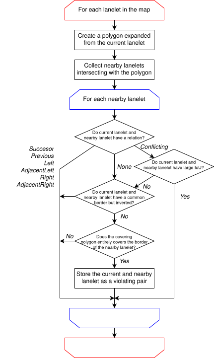
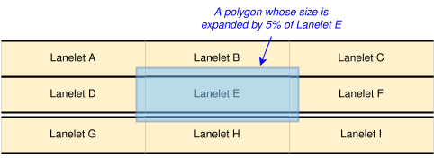
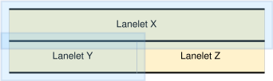
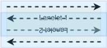

# border_sharing

🇬🇧 [English ver](./border_sharing.md) | 🇯🇵 **日本語 ver**

## 検証器の名前

mapping.lane.border_sharing

## 機能

この検証器は、物理的に隣り合う lanelet どうしが同じ linestring を境界線として共有していること、およびフェンスで隔てられた lanelet どうしが境界線を共有していないことを確認します。
詳しくは Autoware Documentation の [vm-01-03 Linestring sharing](https://autowarefoundation.github.io/autoware-documentation/main/design/autoware-architecture/map/map-requirements/vector-map-requirements-overview/category_lane/#vm-01-03-linestring-sharing) と [vm-01-04 Sharing of the centerline of lanes for opposing traffic](https://autowarefoundation.github.io/autoware-documentation/main/design/autoware-architecture/map/map-requirements/vector-map-requirements-overview/category_lane/#vm-01-04-sharing-of-the-centerline-of-lanes-for-opposing-traffic) を参照してください。

この検証器は、実際には隣り合っていないものの、非常に近い lanelet を誤って判定することがあります。

この検証器は、次の issue を、対応する primitive の ID とともに出力します。"Lane.BorderSharing-001" と "Lane.BorderSharing-002" の違いは [アルゴリズム](#アルゴリズム) を、"Lane.BorderSharing-003" と "Lane.BorderSharing-004" は [フェンスを挟んで境界線を共有する lanelet](#フェンスを挟んで境界線を共有する-lanelet) を参照してください。

| Issue Code             | Message                                                                                                    | Severity | Primitive | 説明                                                                                                                                                                                                                                                                                                                                                         | 直し方                                                                                                                                                                                                                     |
| ---------------------- | ---------------------------------------------------------------------------------------------------------- | -------- | --------- | ------------------------------------------------------------------------------------------------------------------------------------------------------------------------------------------------------------------------------------------------------------------------------------------------------------------------------------------------------------ | -------------------------------------------------------------------------------------------------------------------------------------------------------------------------------------------------------------------------- |
| Lane.BorderSharing-001 | "Lanelet \<ID\> と隣接しているようですが、境界線を同一の linestring で共有していません。"                  | Error    | Lanelet   | 検証器は、この lanelet と lanelet \<ID\> が、境界線の上にフェンスが無く隣り合っているのに、境界線の linestring を共有していないと判定しました。**同じ issue が lanelet \<ID\> にも出力されるので、1 つの違反から 2 つの issue が出力されることに注意してください。**                                                                                         | 2 つの lanelet に共通の境界線 linestring を作り、両方の left bound か right bound にしてください。実際の地形で 2 つのあいだにフェンスがある場合は、代わりに、境界線の point を使ってフェンスを境界線の上に描いてください。 |
| Lane.BorderSharing-002 | "複数の Lanelet \<multiple IDs\> と隣接しているようですが、境界線を同一の linestring で共有していません。" | Error    | Lanelet   | 検証器は、この lanelet と lanelet \<ID\> が、境界線の上にフェンスが無く隣り合っているのに、境界線の linestring を共有していないと判定しました。上の issue との違いは、この違反が lanelet の区切り方の誤りから起きている可能性があることと、issue が最も大きい lanelet にだけ出力されることです（lanelet \<multiple IDs\> には同じ issue は出力されません）。 | この lanelet を適切に区切り、隣り合う各 lanelet と共通の境界線を設定してください。実際の地形で 2 つのあいだにフェンスがある場合は、代わりに、境界線の point を使ってフェンスを境界線の上に描いてください。                 |
| Lane.BorderSharing-003 | "Lanelet \<ID\> とのあいだにフェンスがありますが、境界線を同一の linestring で共有しています。"            | Error    | Lanelet   | この lanelet と lanelet \<ID\> は境界線の linestring を共有しており、境界線の上に `type:fence` の linestring があります。**同じ issue が lanelet \<ID\> にも出力されるので、1 つの違反から 2 つの issue が出力されることに注意してください。**                                                                                                               | 2 つの lanelet の境界線を別々の linestring にしてください。実際の地形にフェンスが無い場合は、代わりに地図からフェンスの linestring を消してください。                                                                      |
| Lane.BorderSharing-004 | "Lanelet \<ID\> と、type が fence の境界線 linestring を共有しています。"                                  | Error    | Lanelet   | この lanelet と lanelet \<ID\> は、type が `fence` の境界線 linestring を共有しています。**同じ issue が lanelet \<ID\> にも出力されるので、1 つの違反から 2 つの issue が出力されることに注意してください。**                                                                                                                                               | 2 つの lanelet の境界線を別々の linestring にしてください。実際の地形にフェンスが無い場合は、代わりに、共有している境界線の type を `fence` 以外に直してください。                                                         |

## アルゴリズム

### 概要

アルゴリズムの概要を、次のフローチャートに示します。

境界線の共有の決まりに反する lanelet の組を集めたあと、検証器は、それぞれの組に逆向きの組があるかどうかで分類します。組 (Lanelet1, Lanelet2) と (Lanelet2, Lanelet1) の両方が見つかった場合は、それぞれの lanelet を広げた多角形が、もう一方の境界線を覆っていることを意味します。この組は `Lane.BorderSharing-001` に分類します。組が 1 つだけで逆向きの組が無い場合は、`Lane.BorderSharing-002` に分類します。組 (Lanelet 1, Lanelet2) と (Lanelet 1, Lanelet3) があり、(Lanelet 2, Lanelet1) と (Lanelet 3, Lanelet1) が無い場合は、まとめて Lanelet 1 の 1 つの issue にし、その issue のメッセージで Lanelet 2 と 3 を挙げます。

### 例 1

次の例を見てみます。この例では、Lanelet D、E、F が、それぞれ Lanelet G、H、I と境界線の linestring を共有すべきです。

Lanelet E を検証するとき、`mapping.lane.border_sharing` は、まず Lanelet E を広げた多角形を作り、その多角形と交わる Lanelet A〜I を候補として集めます。次に、Lanelet E との関係を求めます。結果は次の表のとおりです。

| Lanelet               | 関係      |
| --------------------- | --------- |
| Lanelet B             | Left      |
| Lanelet D             | Previous  |
| Lanelet F             | Successor |
| Lanelet A, C, G, H, F | None      |

フローチャートに従い、Lanelet B、D、F を候補から外します。残った lanelet の left bound と right bound が多角形に完全に覆われているかを調べると、多角形に覆われているのは Lanelet H の境界線だけです。さらに、Lanelet H を検証したときも、広げた多角形が Lanelet E の境界線を覆うという同じ結果になります。そのため、Lanelet E と Lanelet H の両方に、issue コード `Lane.BorderSharing-001` の issue を出力します。

### 例 2

もう 1 つの例として、次のように、隣り合う lanelet と区切り方が違う場合を見てみます。

この場合、Lanelet X を広げた多角形は Lanelet Y と Z の境界線を覆いますが、Lanelet Y を広げた多角形は Lanelet X の境界線を覆いません。このとき、Lanelet X に issue コード `Lane.BorderSharing-002` の issue を出力します。

### フェンスで隔てられた lanelet

フェンスで隔てられた lanelet どうしは、境界線を共有する必要がありません。そのため、もう一方の lanelet を広げた多角形に覆われた境界線の上にフェンスがある場合、その lanelet の組は `Lane.BorderSharing-001` と `Lane.BorderSharing-002` の対象から外します。境界線の type が `fence` である場合、または type が `fence` の linestring が境界線の少なくとも 1 区間（連続する 2 点）と同じ位置にある場合、境界線の上にフェンスがあるとします。「同じ位置」とは、2 本の linestring が同じ point を使うこと、または点の座標が高さを含めて同じであることです。

## フェンスを挟んで境界線を共有する lanelet

上のアルゴリズムとは別に、この検証器は、lanelet が境界線として共有している linestring をすべて調べます。その linestring を共有する lanelet の組ごとに、次の条件にすべて当てはまる場合に issue を出力します。

1. 少なくとも一方の lanelet が `subtype:road` である。road の lanelet を含まない組では、境界線の共有の有無が Autoware の走行に影響しないため、検査する意義がありません。
2. 2 つの lanelet が、共有している linestring の両側に分かれている。側は、linestring がそれぞれの lanelet の left bound と right bound のどちらかと、linestring の向きから決めます。
3. 共有している linestring の上にフェンスがある。issue code は、フェンスの描き方で決まります。
   - `Lane.BorderSharing-003`: type が `fence` の別の linestring が、共有している linestring の少なくとも 1 区間（連続する 2 点）と同じ位置にある。ほかの位置（lanelet の中など）にあるフェンスは考えません。
   - `Lane.BorderSharing-004`: 共有している linestring そのものの type が `fence` である。

条件 3 の両方に当てはまる場合は、両方の issue を出力します。

この判定は、地図ファイルに書かれたフェンスだけを使います。物（フェンス、ポール、中央分離帯など）が実際にあるかどうかは推し量りません。そのため、地図ファイルにフェンスが描かれていないまま境界線を共有した lanelet は、検出しません。

## 判定が難しい場合

「隣り合う lanelet」の判定にはあいまいさがあるので、検証器が境界線の共有の決まりへの違反を誤って判定する場合があります。

### 隣り合ってはいないが、近すぎる lanelet

離して作るべき 2 つの lanelet が非常に近いと、検証器は、それらが隣り合っているのに共通の境界線を持っていないと誤って判定することがあります。

### 境界線と違う point で描かれたフェンス

フェンスが境界線の上にあるとみなすのは、フェンスが境界線の区間と同じ位置の区間を持つ場合だけです。フェンスが境界線と違う point で描かれている場合（境界線の両端の 2 点だけを使う場合など）、検証器は、そのフェンスが境界線の上にあるとはみなしません。その結果、そのような境界線を共有する lanelet には `Lane.BorderSharing-003` を出力せず、そのようなフェンスで隔てられた lanelet には `Lane.BorderSharing-001` か `Lane.BorderSharing-002` を出力することがあります。これを避けるには、境界線の point を使ってフェンスを描いてください。

### 疑似的な双方向の lanelet

Autoware では、lanelet は一方向を前提としています。そのため、双方向の lanelet を作りたいときは、次のように、ある lanelet の上に逆向きの lanelet を重ねて置くことがあります。

広げた多角形がほかの lanelet の境界線を覆ってしまうので、Conflicting の関係にある lanelet については IoU（intersection over union）を計算しています。IoU が 0.05 より大きく、多角形が境界線の linestring を覆っている場合は、この例のような疑似的な双方向の lanelet である可能性が高いとみなします。言い換えると、この検証器は、IoU が小さい組だけを隣り合う lanelet と判定します。

## パラメータ

この検証器には、次のパラメータがあります。

| パラメータ    | 既定値 | 説明                                                                                                                                                                                                                                                                                                             |
| ------------- | ------ | ---------------------------------------------------------------------------------------------------------------------------------------------------------------------------------------------------------------------------------------------------------------------------------------------------------------- |
| iou_threshold | 0.05   | 広げた多角形と候補の lanelet の重なりが、意図して重ねたとみなすほど大きくはないことを見分けるためのしきい値です。IoU がこの値より小さい場合、検証器はそれらが物理的に隣り合っているとみなします。数値の例として、同じ形の 2 つの長方形が隣り合い、その一方を中心から 5 % 広げた場合、IoU は約 0.024 になります。 |

## 関連するソースコード

- border_sharing.cpp
- border_sharing.hpp
